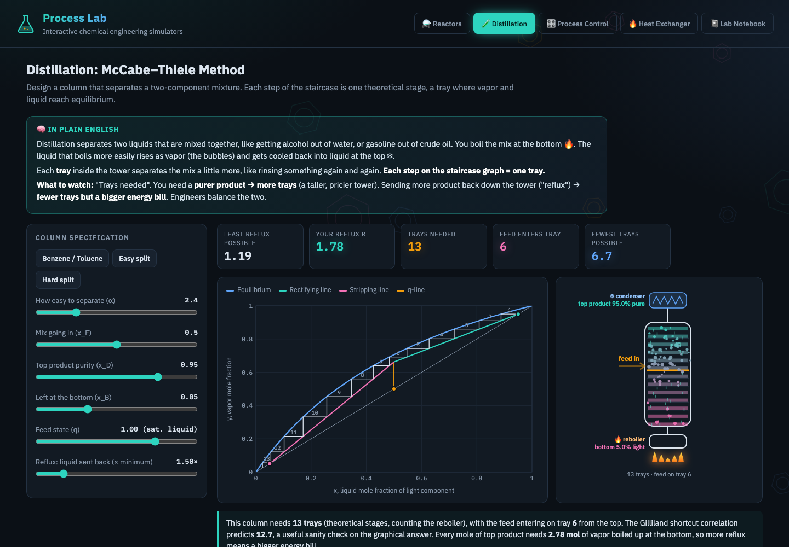
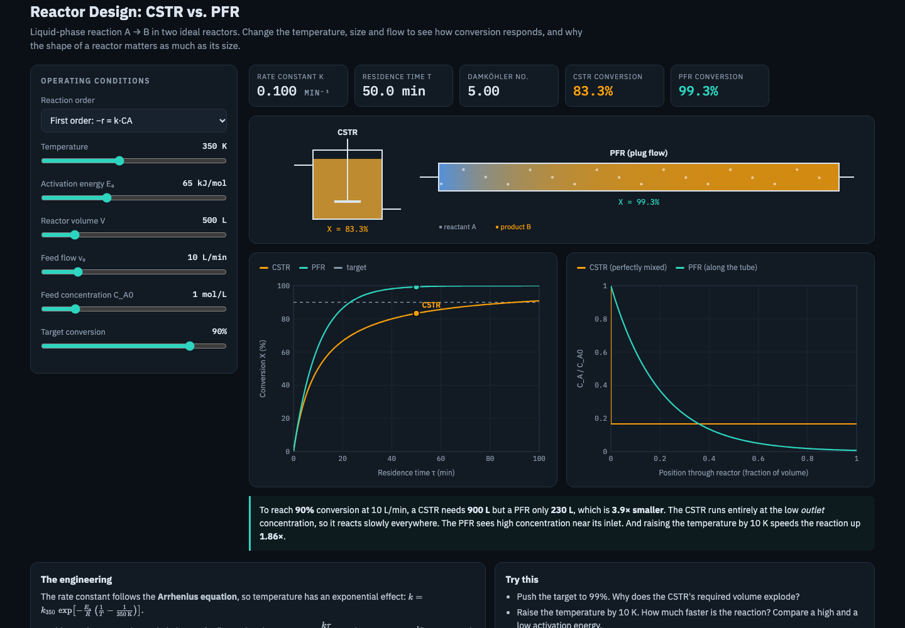
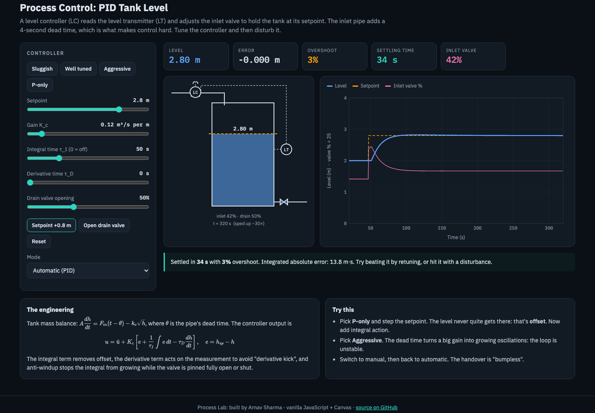
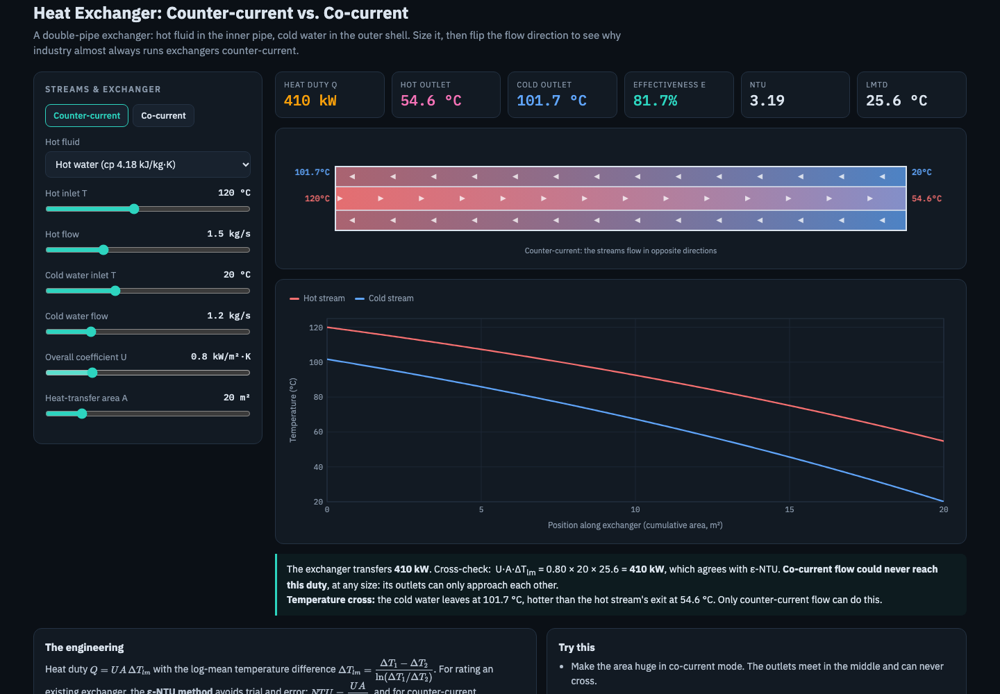
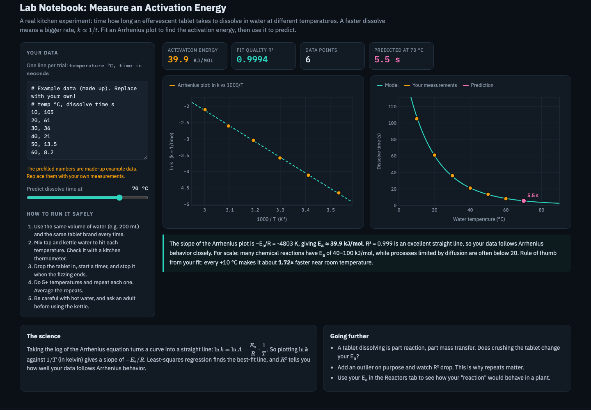
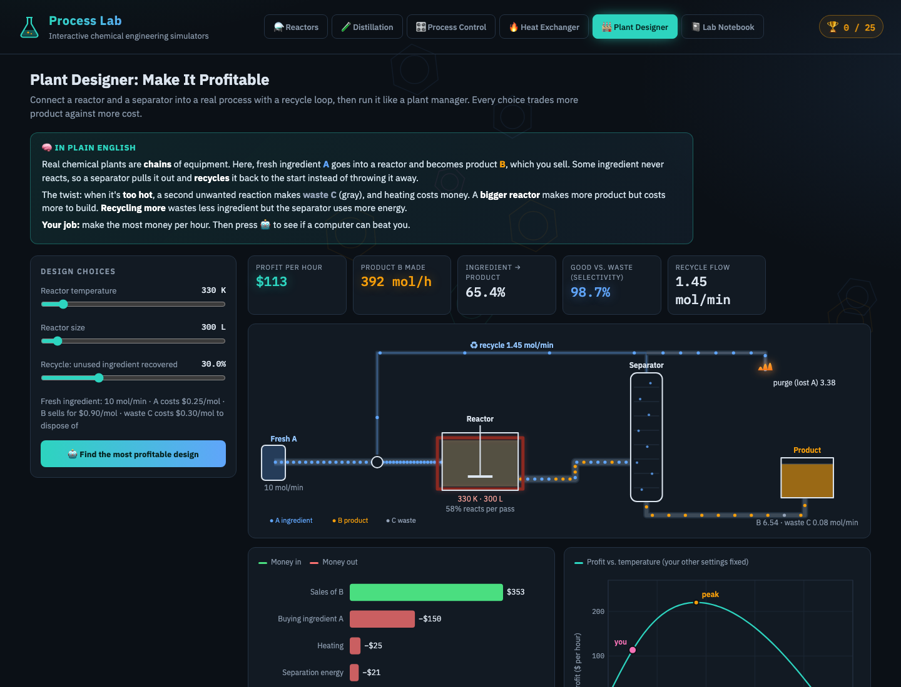

# ⚗️ Process Lab: interactive chemical engineering simulators

**▶ Try it live: https://arnav080603.github.io/process-lab/**

Six browser-based simulators covering core topics from a chemical engineering degree, from reaction engineering to plant economics. Each one is built from first principles and has its equations written out, so you can see *why* the numbers come out the way they do.

Every tab also has a **🧠 plain-English explanation** with everyday analogies, **🏆 missions** to complete (25 badges in total, with confetti), and a **quiz** that explains each answer. That way it works as a learning tool, not just a calculator.

## Modules

| Module | What you can do | Engineering behind it |
|---|---|---|
| **⚗️ Reactors** | Compare a CSTR and a PFR, change temperature, volume, flow and reaction order, and find the volume needed for a target conversion | Arrhenius kinetics, design equations for ideal reactors, Damköhler number |
| **🧪 Distillation** | Design a binary column graphically: watch the McCabe–Thiele staircase, minimum reflux pinch and feed-stage location update live | VLE with constant relative volatility, q-line, Rmin, Fenske equation, Gilliland correlation |
| **🎛️ Process Control** | Tune a PID level controller on an animated P&amp;ID, step the setpoint, open a drain valve, switch to manual | Dynamic tank mass balance with dead time, PID with anti-windup and bumpless transfer, offset vs. integral action, instability |
| **🔥 Heat Exchanger** | Size a double-pipe exchanger and flip between counter- and co-current flow | ε-NTU method, LMTD, energy balances, temperature cross |
| **🏭 Plant Designer** | Run a whole plant (reactor → separator → recycle loop) and maximize profit per hour, then race a 🤖 optimizer | Parallel reactions and selectivity, recycle mole balance (solved exactly as a quadratic), process economics, grid-search optimization |
| **📓 Lab Notebook** | Enter your own experiment data and fit an activation energy | Linearized Arrhenius regression, R², extrapolation |

## Screenshots

| Reactors | Process control |
|---|---|
|  |  |
| **Heat exchanger** | **Lab notebook** |
|  |  |
| **Plant designer** | |
|  | |

## Validation

I checked the models against textbook answers:
- **Distillation**, α = 2.5, xF = 0.5, xD = 0.95, xB = 0.05, saturated-liquid feed: Rmin = 1.10 and Nmin = 6.43 (both match the hand calculation). At R = 1.5 Rmin, the staircase gives 12 stages, while the Gilliland correlation estimates 12.3.
- **Reactors:** first order with Da = 10 gives XCSTR = 0.909 and XPFR = 0.99995. For second order, the CSTR solution satisfies Da(1−X)² = X exactly. Required-volume formulas round-trip back to the target conversion.
- **Heat exchanger:** Q from ε-NTU equals U·A·ΔTlm and both streams' energy balances to machine precision. With Cr = 1 and NTU = 1, ε = 0.5 as expected.
- **Process control:** the "well tuned" preset settles a 0.8 m setpoint step in about 34 s with 3% overshoot and rejects a drain-valve disturbance. The "aggressive" preset oscillates indefinitely, and P-only control leaves a steady-state offset, as theory predicts.

- **Plant designer:** the closed-form recycle solution matches brute-force fixed-point iteration to 5 decimal places, and the overall mole balance (A in = B + C + purged A) closes to about 1e-12. The economics are tuned so the profit optimum sits inside the design space (≈346 K, 93.5% recycle), not at a slider limit.

## The real experiment
The Lab Notebook pairs with a kitchen-safe experiment: time how long an effervescent tablet takes to dissolve at different water temperatures, then fit an Arrhenius plot to estimate an activation energy. The prefilled numbers are clearly labelled example data.

## Tech
A single `index.html`: vanilla JavaScript with hand-written Canvas charts and animations (no charting library), and KaTeX for the equations. No build step, no backend. To run it locally, open the file or run `python3 -m http.server`.

*Built by Arnav Sharma with help from AI coding tools (Claude Code). I chose the topics, checked the results against textbook methods, and plan to study chemical engineering.*
